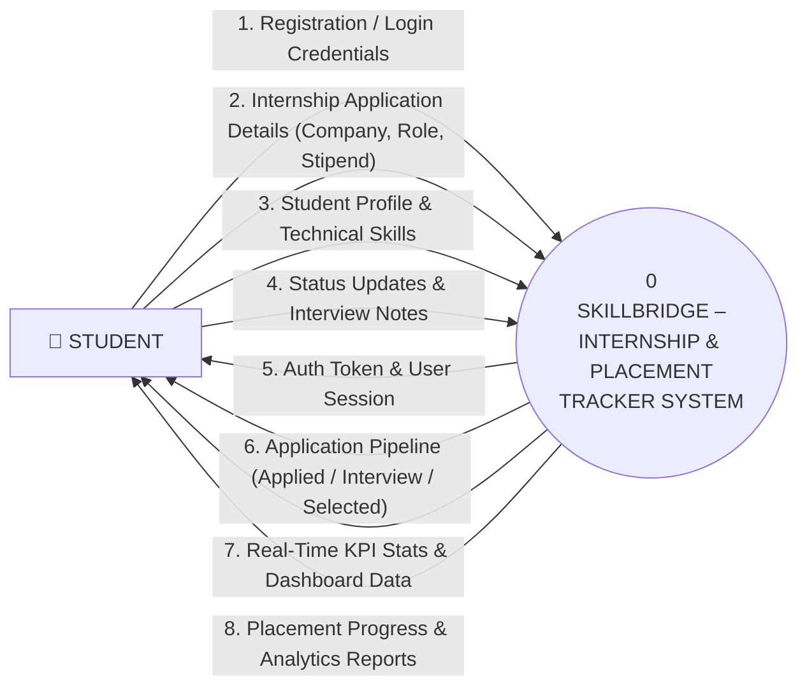
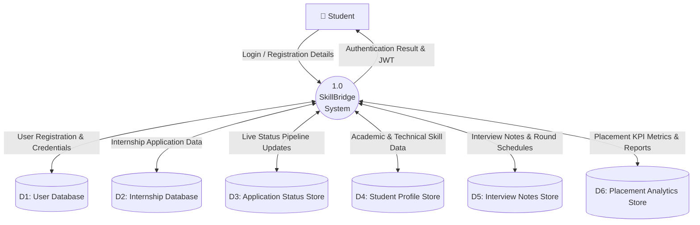
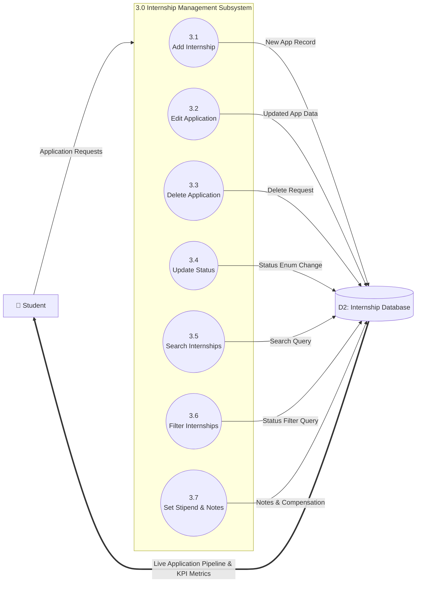
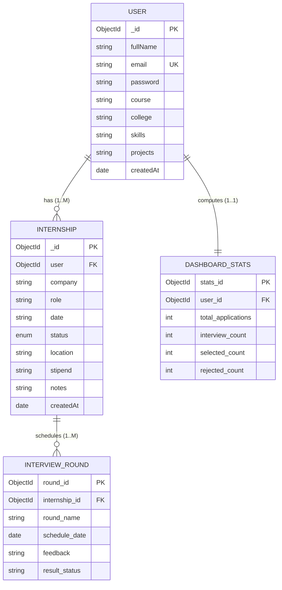
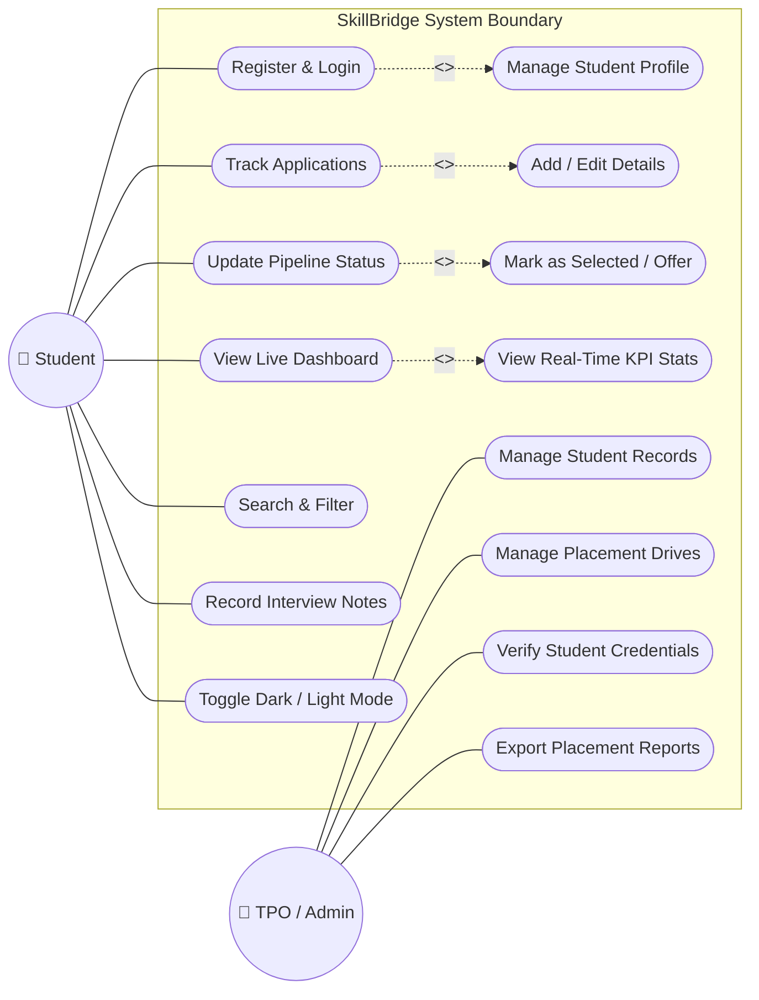
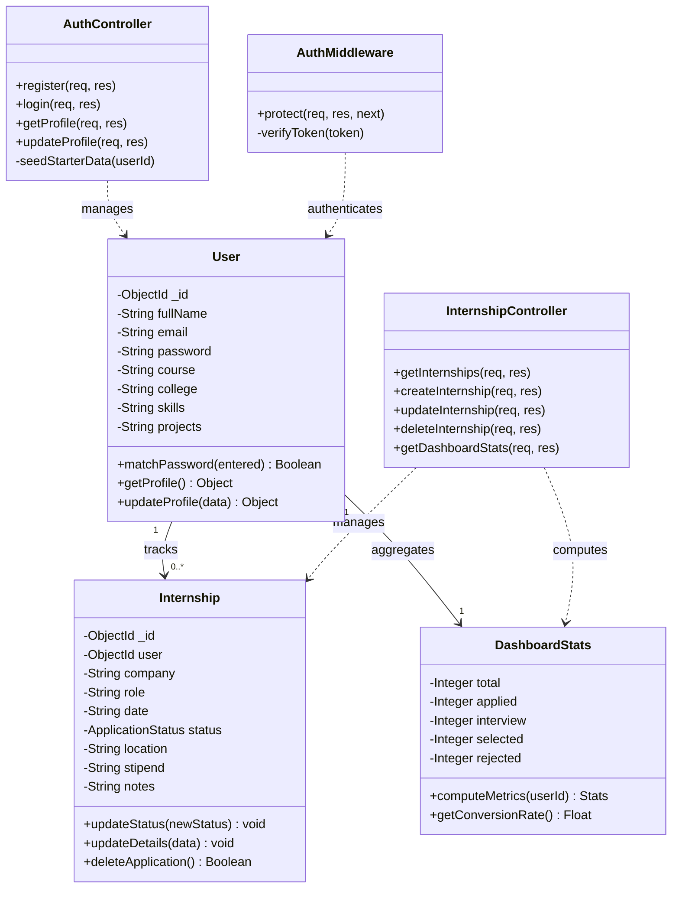

# SkillBridge - Complete System Diagrams Documentation 📊

This document contains the academic and industry-standard technical diagrams for the **SkillBridge (Student Internship & Placement Tracker)** project, modeled and referenced directly from the project architecture and the diagrams repository.

---

## Table of Contents
1. [Zero Level DFD (Context Level Diagram)](#1-zero-level-dfd-context-level-diagram)
2. [First Level DFD (Level 1.0)](#2-first-level-dfd-level-10)
3. [Second Level DFD – Internship Management (3.0)](#3-second-level-dfd--internship-management-30)
4. [Entity Relationship Diagram (ERD)](#4-entity-relationship-diagram-erd)
5. [UML Use Case Diagram](#5-uml-use-case-diagram)
6. [UML Class Diagram](#6-uml-class-diagram)
7. [Vector Diagram Files Inventory](#7-vector-diagram-files-inventory)

---

## 1. Zero Level DFD (Context Level Diagram)

The Zero-Level Data Flow Diagram (Context Level DFD) represents the entire **SkillBridge** system as a single central process interacting with the external environment (**Student** entity).

### Vector Graphic File
📄 Located at: `diagrams/zero_level_dfd.svg`

### Mermaid Flowchart Representation

### Data Flow Dictionary (Context Level)
| Flow Name | Source | Destination | Description |
|---|---|---|---|
| `Registration / Login Details` | Student | System | Full Name, Email, Password, Course, College |
| `Internship Application Details` | Student | System | Company, Position Role, Date, Stipend, Mode |
| `Status Updates & Notes` | Student | System | Pipeline status change, technical interview notes |
| `Auth Token & User Session` | System | Student | Bearer JWT token with authenticated student profile |
| `Application Pipeline` | System | Student | Real-time list of all user internship cards |
| `Dashboard KPI Stats` | System | Student | Count of total applications, interviews, and offers |

---

## 2. First Level DFD (Level 1.0)

The First-Level DFD decomposes the system into data flows connecting the central process to distinct database stores (`D1` through `D6`).

### Vector Graphic File
📄 Located at: `diagrams/first_level_dfd.svg`

### Mermaid Flowchart Representation

### Data Store Specifications
- **D1 User Database**: Stores student identity (`fullName`, `email`, hashed `password`).
- **D2 Internship Database**: Stores core applications (`company`, `role`, `date`, `location`, `stipend`).
- **D3 Application Status Store**: Tracks stage state (`Applied`, `Interview`, `Selected`, `Rejected`).
- **D4 Student Profile Store**: Stores academic degree, college, skill tags, and featured projects.
- **D5 Interview Notes Store**: Keeps recruiter remarks, round dates, and preparation notes.
- **D6 Placement Analytics Store**: Pre-computed metrics for dashboard cards and charts.

---

## 3. Second Level DFD – Internship Management (3.0)

Decomposes the core **Internship Management Subsystem (3.0)** into granular sub-processes (3.1 to 3.7), matching the reference task management diagram.

### Vector Graphic File
📄 Located at: `diagrams/second_level_dfd.svg`

### Mermaid Flowchart Representation

### Key Subprocesses
1. **3.1 Add Internship**: Validates and inserts a new company application record.
2. **3.2 Edit Application**: Updates role title, application date, or location.
3. **3.3 Delete Application**: Deletes application after user confirmation.
4. **3.4 Update Status**: Real-time transition between `Applied`, `Interview`, `Selected`, `Rejected`.
5. **3.5 Search Internships**: Instant client/server query across company name and role.
6. **3.6 Filter Internships**: Quick status filter tab filtering.
7. **3.7 Set Stipend & Notes**: Logs compensation details and technical round notes.

---

## 4. Entity Relationship Diagram (ERD)

The ERD illustrates the database schema entities, primary/foreign keys, and relational cardinality.

### Vector Graphic File
📄 Located at: `diagrams/er_diagram.svg`

### Mermaid ERD Representation

---

## 5. UML Use Case Diagram

Models user and administrative functional capabilities, including `<<include>>` and `<<extend>>` dependencies.

### Vector Graphic File
📄 Located at: `diagrams/uml_use_case_diagram.svg`

### Mermaid Use Case Representation

---

## 6. UML Class Diagram

Displays the object-oriented structure of the Mongoose models, Express controllers, and middleware.

### Vector Graphic File
📄 Located at: `diagrams/class_diagram.svg`

### Mermaid Class Diagram Representation

---

## 7. Gantt Chart (16 Weeks Project Schedule) 📅

The Gantt Chart represents the comprehensive software development lifecycle (SDLC) schedule for **SkillBridge**, spanning **16 weeks** from topic selection to the final viva presentation.

### Image & Vector Files
- **Color Version**: [`gantt_chart.png`](file:///F:/Mini%20Projectt/SkillBridgee/diagrams/gantt_chart.png) & [`gantt_chart.svg`](file:///F:/Mini%20Projectt/SkillBridgee/diagrams/gantt_chart.svg)
- **Academic Grayscale**: [`gantt_chart_grayscale.png`](file:///F:/Mini%20Projectt/SkillBridgee/diagrams/gantt_chart_grayscale.png) & [`gantt_chart_grayscale.svg`](file:///F:/Mini%20Projectt/SkillBridgee/diagrams/gantt_chart_grayscale.svg)

### 16-Week Task Breakdown
| # | Task Description | Timeline | Deliverables / Milestones |
|---|---|---|---|
| 1 | **Project Topic Selection** | Week 1 | Problem statement definition, scope & technology stack finalization |
| 2 | **Requirement Gathering** | Weeks 1 – 2 | Functional & non-functional requirements specification (SRS) |
| 3 | **System Analysis** | Weeks 2 – 3 | Feasibility study, DFD levels 0/1/2, UML Use Case & Class diagrams |
| 4 | **UI/UX Design** | Weeks 3 – 4 | Wireframing, responsive layouts, color scheme, tactile button design |
| 5 | **Database Design** | Weeks 4 – 5 | Entity-Relationship diagram, MongoDB schemas (User, Internship) |
| 6 | **Frontend Development** | Weeks 4 – 7 | React 19 + Vite setup, responsive components, CSS custom properties |
| 7 | **Backend Development** | Weeks 5 – 8 | Express 4 REST API, MongoDB connection, JWT auth, CRUD controllers |
| 8 | **Internship Management Module** | Weeks 6 – 8 | Add, edit, delete, status toggle, notes, stipend tracking |
| 9 | **Application Tracking Module** | Weeks 7 – 9 | Search, multi-criteria filtering, pipeline card views |
| 10 | **Interview Prep & Notes Module** | Weeks 8 – 10 | Company-specific interview notes, round status logging |
| 11 | **Dashboard & Analytics Module** | Weeks 9 – 11 | Live KPI stat cards (Total, Applied, Interview, Selected, Rejected) |
| 12 | **Integration** | Weeks 11 – 13 | Frontend-backend API proxy binding, token storage, auth guard |
| 13 | **Testing and Debugging** | Weeks 12 – 14 | Unit tests, endpoint testing via Postman/Curl, responsive audits |
| 14 | **Documentation** | Weeks 13 – 16 | Final project report, diagram exports, user manual, README |
| 15 | **Final Presentation** | Week 16 | Presentation slide deck, live deployment demo, viva defense |

---

## 8. Complete Project Diagrams & Charts Inventory

All high-resolution **PNG (2000px)** and **SVG** vector files are saved in [`diagrams/`](file:///F:/Mini%20Projectt/SkillBridgee/diagrams):

| Diagram / Chart Name | PNG Link (2000px High-Res) | SVG Source |
|---|---|---|
| **Gantt Chart (Executive Blue)** | [**`gantt_chart.png`**](file:///F:/Mini%20Projectt/SkillBridgee/diagrams/gantt_chart.png) | [`gantt_chart.svg`](file:///F:/Mini%20Projectt/SkillBridgee/diagrams/gantt_chart.svg) |
| **Gantt Chart (Academic Grayscale)** | [**`gantt_chart_grayscale.png`**](file:///F:/Mini%20Projectt/SkillBridgee/diagrams/gantt_chart_grayscale.png) | [`gantt_chart_grayscale.svg`](file:///F:/Mini%20Projectt/SkillBridgee/diagrams/gantt_chart_grayscale.svg) |
| **Zero Level DFD (Context Level)** | [**`zero_level_dfd.png`**](file:///F:/Mini%20Projectt/SkillBridgee/diagrams/zero_level_dfd.png) | [`zero_level_dfd.svg`](file:///F:/Mini%20Projectt/SkillBridgee/diagrams/zero_level_dfd.svg) |
| **First Level DFD (Core System)** | [**`first_level_dfd.png`**](file:///F:/Mini%20Projectt/SkillBridgee/diagrams/first_level_dfd.png) | [`first_level_dfd.svg`](file:///F:/Mini%20Projectt/SkillBridgee/diagrams/first_level_dfd.svg) |
| **Second Level DFD (Internship Lifecycle)** | [**`second_level_dfd.png`**](file:///F:/Mini%20Projectt/SkillBridgee/diagrams/second_level_dfd.png) | [`second_level_dfd.svg`](file:///F:/Mini%20Projectt/SkillBridgee/diagrams/second_level_dfd.svg) |
| **Entity-Relationship (ER) Diagram** | [**`er_diagram.png`**](file:///F:/Mini%20Projectt/SkillBridgee/diagrams/er_diagram.png) | [`er_diagram.svg`](file:///F:/Mini%20Projectt/SkillBridgee/diagrams/er_diagram.svg) |
| **UML Use Case Diagram** | [**`uml_use_case_diagram.png`**](file:///F:/Mini%20Projectt/SkillBridgee/diagrams/uml_use_case_diagram.png) | [`uml_use_case_diagram.svg`](file:///F:/Mini%20Projectt/SkillBridgee/diagrams/uml_use_case_diagram.svg) |
| **UML Class Diagram** | [**`class_diagram.png`**](file:///F:/Mini%20Projectt/SkillBridgee/diagrams/class_diagram.png) | [`class_diagram.svg`](file:///F:/Mini%20Projectt/SkillBridgee/diagrams/class_diagram.svg) |
| **MongoDB Atlas Database View** | [**`mongodb_atlas_view.png`**](file:///F:/Mini%20Projectt/SkillBridgee/diagrams/mongodb_atlas_view.png) | [`mongodb_atlas_view.svg`](file:///F:/Mini%20Projectt/SkillBridgee/diagrams/mongodb_atlas_view.svg) |

